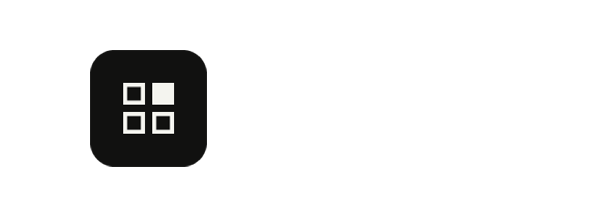
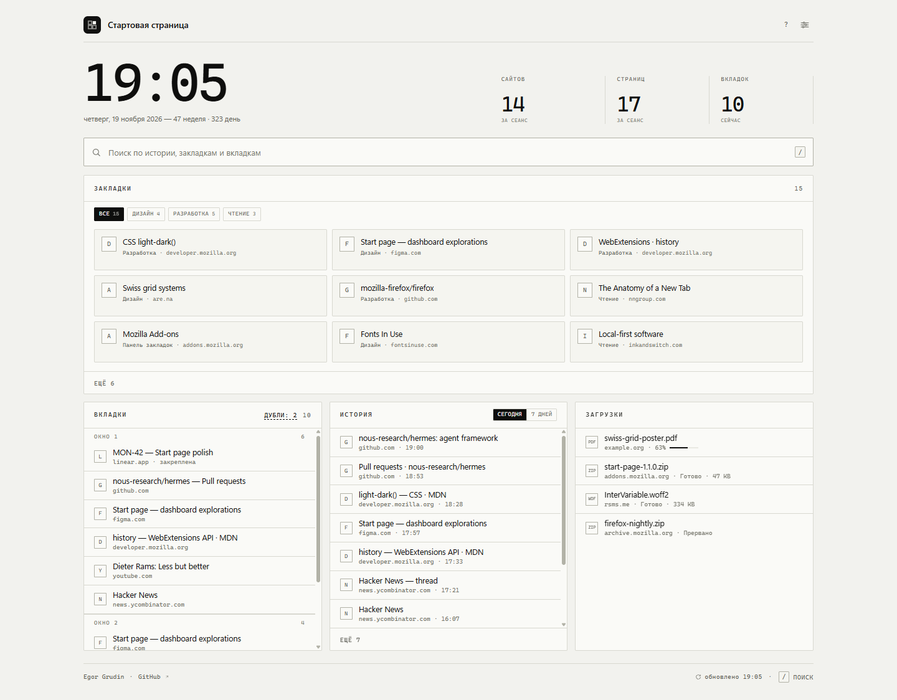
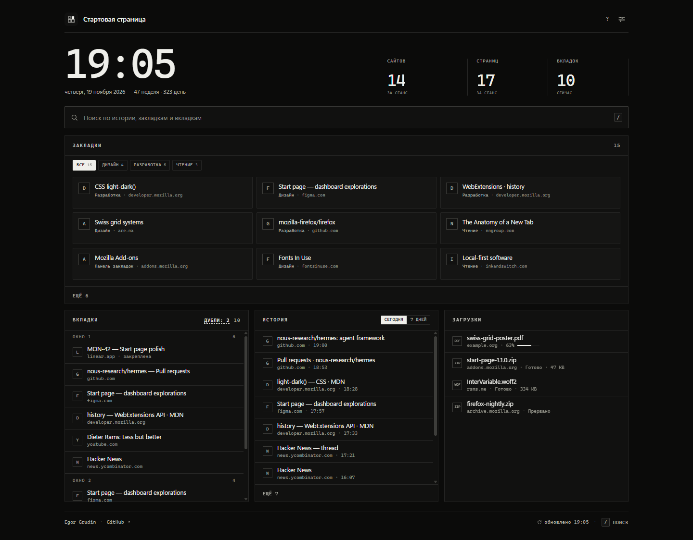
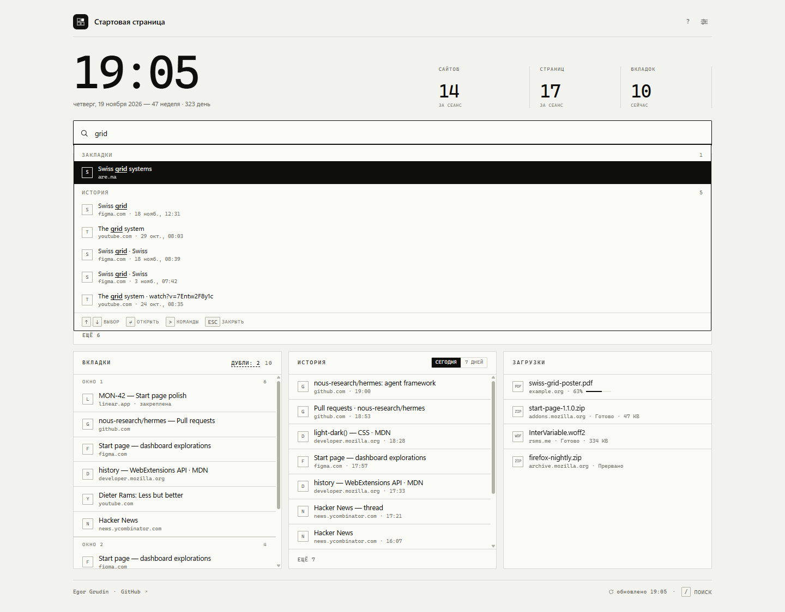
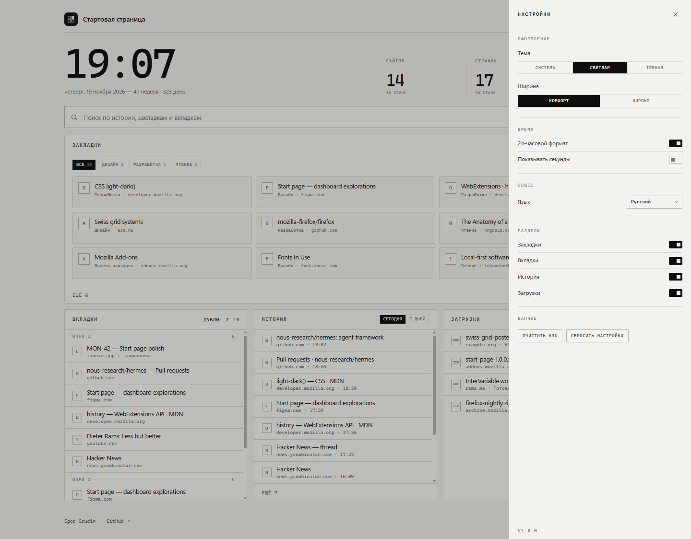

  

  
  
  
  
  

---

**StartPage** — расширение Firefox, которое открывается при запуске браузера и показывает сводку профиля: закладки, открытые вкладки, историю за сеанс и последние загрузки.

  
  

## Возможности

### Запуск

- При старте Firefox «Стартовая страница» открывается сама.
- Вручную страницу можно открыть кнопкой на панели или сочетанием `Alt + Shift + M`.
- Новые вкладки остаются стандартными: расширение их не переопределяет.

### Сводка за сеанс

- Три живых показателя: **сайты**, **страницы** и **открытые вкладки**.
- Сайты и страницы считаются с начала сеанса Firefox, вкладки — по фактически открытым сейчас.
- Часы, дата, номер недели и день года.

### Закладки

- Отдельный блок на всю ширину.
- Папки-фильтры со счётчиками и сетка карточек.
- Название, папка, домен, копирование ссылки и открытие в новой вкладке.
- «Ещё N» для остальных закладок и пустые состояния для папок и библиотеки.

### Вкладки

- Открытые вкладки с группировкой по окнам.
- Закреплённые вкладки и закрытие отдельной вкладки.
- Поиск дублей по URL и закрытие копий с подтверждением.

### История

- Режимы «Сегодня» и «7 дней».
- Время визита и домен, открытие в текущей или новой вкладке.
- Добавление в закладки и удаление записи с подтверждением.

### Загрузки

- Последние загрузки, статус, размер и прогресс.
- Открытие готового файла и показ в папке.

### Палитра

  

- `/` или `Ctrl/⌘ K` открывает поиск по **закладкам, истории и вкладкам**.
- Поиск идёт только по локальным данным браузера, без интернет-поиска.
- `>` открывает команды: сменить тему, открыть настройки, показать клавиши, закрыть дубли, обновить сводку.

### Оформление и настройки

- Системная, светлая и тёмная темы; комфортная или широкая ширина; системные шрифты.
- 24-часовой формат, секунды, язык интерфейса (авто / русский / английский).
- Включение и выключение четырёх разделов, очистка кэша и сброс настроек.

  

### Приватность

- Полностью локальная работа: без сетевых запросов, аналитики, рекламы и внешних шрифтов или CDN.
- Данные браузера не покидают устройство.

## Горячие клавиши

| Действие | Клавиши |
| --- | --- |
| Поиск и палитра | `/` или `Ctrl/⌘ K` |
| Навигация по результатам | `↑` `↓` |
| Открыть | `Enter` |
| Открыть в новой вкладке | `Ctrl/⌘ Enter` |
| Команды в палитре | `>` |
| Закрыть / сбросить | `Esc` |
| Настройки | `Alt + ,` |
| Подсказка по клавишам | `?` |
| Открыть стартовую страницу с панели | `Alt + Shift + M` |

## Разрешения

| Разрешение | Зачем |
| --- | --- |
| `history` | История за сеанс и 7 дней, счётчики, удаление записи по просьбе пользователя. |
| `bookmarks` | Библиотека и папки, добавление и удаление закладки. |
| `tabs` | Названия и адреса открытых вкладок, активация, закрытие, поиск дублей. |
| `downloads` | Последние загрузки, прогресс, открытие файла и показ в папке. |
| `storage` | Настройки, кэш снимка и отметка начала сеанса. |

## Лицензия

Проект распространяется по лицензии [MIT](./LICENSE) © 2026 Egor Grudin. Код можно использовать, изменять и распространять, в том числе в коммерческих целях, при условии сохранения уведомления об авторских правах и текста лицензии.
